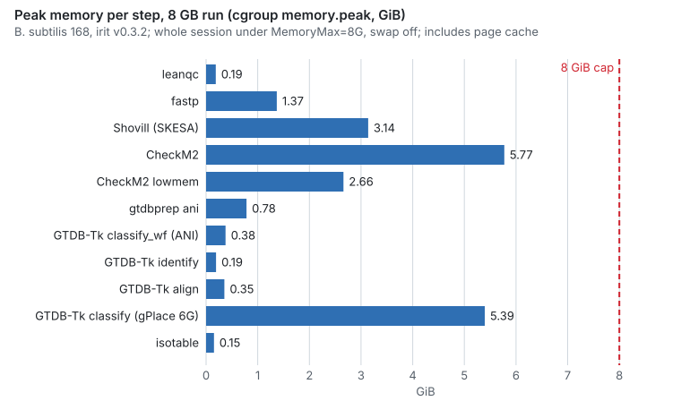

# Reads to GTDB species on a laptop, through irit-mcp

Can the irit tools take one bacterial isolate from raw Illumina reads to a GTDB species call on an
ordinary laptop, driven only through `irit-mcp`'s typed tools, inside 8 GB of memory? And can the
run be repeated afterwards without the AI, from its own record?

This page answers both for one genome, *Bacillus subtilis* 168. It was run on 2026-11-12 with the
irit v0.3.2 release binaries on a 12-core Linux laptop with 30 GB of RAM. Every number below was
measured on that machine unless it is marked **cited** (with a source) or **estimate**.

## Summary

- **The whole run fits in 8 GB.** leanqc → fastp → Shovill (SKESA) → CheckM2 → GTDB species
  call → isotable ran inside a kernel-enforced 16 GB memory cap, then again inside an 8 GB cap,
  with swap off both times. No step was killed. The largest step peaked at 5.82 GiB (CheckM2), and
  the whole 8 GB session peaked at 5.88 GiB without ever reaching its limit.
- **The species call is right.** GTDB-Tk 2.8.0's own ANI screen, given the small reference set
  that `gtdbprep ani` fetched (21 sketches, 60.8 MB), called `s__Bacillus subtilis`: closest
  reference GCF_000009045.1 (strain 168 itself), ANI 100.0, AF 1.0. Tree placement with gPlace
  instead of pplacer gave the same genus, `g__Bacillus`.
- **The assembly and its quality are plausible.** CheckM2: 100.0% complete, 0.03% contamination.
  57 contigs, 4,152,275 bp (98.5% of the reference's length), N50 185,951.
- **Compute took about 17 minutes**, on a laptop that other jobs kept busy (1-minute load average
  17–43 on 12 cores). Downloading the databases took longer: 4 min for the GTDB placement data and
  30 min for the CheckM2 database.
- **The run can be repeated without the AI, but `irit-mcp`'s `replay.sh` needs three steps added.**
  With them, every command reran and every result a person reads came out the same: species, ANI,
  completeness, contamination and the isotable row (byte for byte). Not every file was
  byte-identical: the SKESA assembly varies between runs, and leanqc's JSON changes in the last
  digit of one number.
- **After the fixes (#2–#11), `irit-mcp`'s own `replay.sh` reruns the whole run from an empty
  folder**, with no steps added: 57 of 57 checks passed, and every file that differed is a
  declared volatile one. See [After the fixes](#after-the-fixes).
- **Ten problems found**, none blocking, filed as issues [#2](https://github.com/dzulfikar08/irit/issues/2)
  to [#11](https://github.com/dzulfikar08/irit/issues/11) (see [Gaps found](#gaps-found)).

## Why this genome

The data is ENA run [DRR000852](https://www.ebi.ac.uk/ena/browser/view/DRR000852), "Whole genome
resequencing of B. subtilis subtilis 168 (NAIST)": Illumina Genome Analyzer, paired 2×75 bp,
1,759,752 pairs (263,962,800 bases, 177 MB gzipped). Both files' MD5s matched ENA's.

- **The answer is known.** GTDB R232's representative of `s__Bacillus subtilis` is
  GCF_000009045.1, which is strain 168 itself.
- **The download is small.** The [ANI page](ani-laptop.md) measured 23 references screened in for
  this genome (**cited**), so the species check fetches little. *E. coli* K-12 was not chosen: it
  pulls in 420 references (about 1.2 GB through GTDB's archive), and GTDB-Tk calls it
  `s__G047199095 sp047199095` in R232, not `s__Escherichia coli` (**cited**, same page).
- **The reads are not easy.** Old GA-II data at 62× before trimming, with a failing per-tile
  quality check, test QC and assembly harder than a modern run would.

Only this one genome was run: free disk on the laptop was 3–15 GB during the session, and the
three databases needed most of it.

## Tool versions

| Component | Version | Installed from |
|---|---|---|
| irit (sheetgen, leanqc, isotable, dblock, irit-mcp, gtdbprep) | 0.3.2 | release binaries, `scripts/install.sh` |
| [fastp](https://github.com/OpenGene/fastp) | 1.4.0 | Bioconda |
| [Shovill](https://github.com/tseemann/shovill) | 1.4.2, assembling with [SKESA](https://github.com/ncbi/SKESA) 2.5.1 (also SPAdes 3.15.5, Pilon 1.24, BWA 0.7.19) | Bioconda |
| [CheckM2](https://github.com/chklovski/CheckM2) | 1.1.0 (DIAMOND 2.2.8) | Bioconda |
| [GTDB-Tk](https://github.com/Ecogenomics/GTDBTk) | 2.8.0 (Prodigal 2.6.3, HMMER 3.4, pplacer 1.1.alpha19) | Bioconda |
| [skani](https://github.com/bluenote-1577/skani) | 0.3.1 (as GTDB-Tk pins it) | Bioconda |
| [gPlace](https://github.com/cmc-aau/gPlace) | 0.1.1 at [`695a401`](https://github.com/cmc-aau/gPlace/commit/695a401e0b54cc1bde55a5e1498a0697899b15ea); `gplace check_install` passed | built from source with pip |
| Databases | `checkm2-db-v3`, `gtdbtk-r232-placement-lite`, `gtdbtk-r232-ani-screen` (GTDB R232) | `dblock`, through irit-mcp |
| Machine | Arch Linux, kernel 7.2, 12 cores, 30 GB RAM | |

Every third-party tool was at the version irit-mcp's wrappers pin, and every call reported no
version warnings. The tools were installed with micromamba into four environments (4.0 GB on disk,
2.8 GB of it CheckM2's).

## How the run was driven

**One irit-mcp session per run.** A small client started `irit-mcp` and spoke MCP to it over stdio,
one `tools/call` per step, the way an AI agent would. The session ran in a systemd user scope with
`MemoryMax=16G` (then `8G`) and `MemorySwapMax=0`. Before each call, the client moved the server
into a fresh child cgroup, so each step's memory, CPU time and processes were counted on their own.
Per step it recorded wall time, the cgroup's `memory.peak` (all the step's processes, including
page cache), CPU time, OOM kills and the load average.

**Calls, in order** (16 GB run): `dblock_add` and `dblock_plan` for the three databases;
`dblock_fetch` for each (CheckM2's streamed, to save disk); `leanqc` on the raw reads; `fastp`;
`shovill`; `dblock_verify` with `deep` (every file's SHA-256 and GTDB-Tk's folder hashes, 11.3 GB
in 30 s); `checkm2`; `gtdbtk_classify_wf`; `isotable`.

**Three steps had no irit-mcp tool** and ran directly: creating the output folders, copying
`contigs.fa` to `genomes/b168.fna` so CheckM2 and GTDB-Tk name the genome, and `gtdbprep ani`.

**The species step.** [`gtdbprep ani`](../tools/gtdbprep.md) screens the genome locally against
the `gtdbtk-r232-ani-screen` index, fetches only the reference sketches skani would compare, and
writes a complete GTDB-Tk data folder (`<work>/gtdbtk_data`): the placement-lite folders plus a
small skani database of those references. The sketches were read from GTDB's archive with
`--source gtdb`, which is opt-in: 21 sketches, 60.8 MB in 21 requests. They went into the per-user
cache, so the 8 GB run and the replay fetched nothing. Passing that folder as `data_path` to
irit-mcp's `gtdbtk_classify_wf` passes its data checks, and GTDB-Tk then runs its own ANI screen and
writes its usual summary files. That route works but is not yet documented or recorded
([#4](https://github.com/dzulfikar08/irit/issues/4)).

**The placement check.** A genome assigned by ANI skips tree placement, so placement was tested
separately on the same genome: `gtdbtk identify`, `align --skip_gtdb_refs`, then `classify` with
the ANI screen skipped, on the placement-lite data. pplacer was replaced by gPlace through the
`pplacer` shim described in [gPlace vs pplacer](gplace-checks.md), at `--max_memory 6G`.

## Time and memory per step

Peak memory is the step cgroup's `memory.peak` in GiB, which includes page cache. Threads is what
the step was given; "Load" is the 1-minute load average before the step and the highest seen during
it. Other jobs kept the 12-core machine busy the whole time, so the steps got fewer cores than
they asked for, and these wall times are slower than an idle laptop would give (by how much was not
measured).

### 16 GB cap

| Step | Via | Threads | Wall (s) | Peak (GiB) | CPU (s) | Load before / max |
|---|---|---:|---:|---:|---:|---|
| `dblock_fetch` placement-lite (175 MB download) | irit-mcp | – | 250.4 | 3.95 | 49.3 | 24.2 / 27.2 |
| `dblock_fetch` CheckM2 DB (1.7 GB, streamed) | irit-mcp | – | 1,805.5 | 1.25 | 120.3 | 30.1 / 35.8 |
| `dblock_verify` deep (11.3 GB hashed) | irit-mcp | – | 30.3 | 1.89 | 21.6 | 22.3 / 22.3 |
| leanqc | irit-mcp | 2 | 5.0 | 0.12 | 9.0 | 20.8 / 21.8 |
| fastp | irit-mcp | 8 | 35.1 | 1.47 | 74.9 | 23.3 / 26.0 |
| Shovill (SKESA, `--ram 8`) | irit-mcp | 8 | 440.7 | 2.87 | 1,547.1 | 25.3 / 42.7 |
| CheckM2 | irit-mcp | 8 | 187.0 | **5.82** | 485.1 | 19.3 / 30.7 |
| `gtdbprep ani` (21 sketches fetched, 60.8 MB) | direct | 8 | 65.0 | 1.59 | 34.3 | 29.3 / 29.3 |
| GTDB-Tk `classify_wf` (ANI screen) | irit-mcp | 8 | 5.6 | 0.37 | 6.9 | 19.0 / 19.0 |
| GTDB-Tk identify (placement check) | direct | 8 | 29.1 | 0.19 | 33.2 | 17.1 / 19.2 |
| GTDB-Tk align `--skip_gtdb_refs` | direct | 8 | 2.9 | 0.32 | 4.6 | 19.2 / 19.5 |
| GTDB-Tk classify, gPlace `--max_memory 6G` | direct | 8 | 233.9 | 5.33 | 753.4 | 19.5 / 26.4 |
| isotable | irit-mcp | – | 0.4 | 0.15 | 0.3 | 20.3 / 20.3 |

Compute from leanqc to isotable, without downloads: 1,005 s (about 17 min), or 768 s without the
placement check. The fetches' peaks are page cache from unpacking and hashing; their anonymous
memory stayed at 0.13 GiB or less. Shovill 1.4.2 refuses `--ram` below 8; SKESA and Pilon used at
most 2.9 GiB. gPlace split the class-level tree (54,673 nodes, 42.2 GiB untiled by its own
estimate) into 12 tiles, and the step peaked at 5.33 GiB.

### 8 GB cap

A second session reran every step that does real work, with the databases on disk and the sketches
cached (nothing downloaded).

| Step | Via | Threads | Wall (s) | Peak (GiB) | CPU (s) | Load before / max |
|---|---|---:|---:|---:|---:|---|
| leanqc | irit-mcp | 2 | 5.1 | 0.19 | 8.9 | 17.6 / 17.6 |
| fastp | irit-mcp | 8 | 32.8 | 1.37 | 74.6 | 17.4 / 19.6 |
| Shovill (SKESA) | irit-mcp | 8 | 402.2 | 3.14 | 1,511.5 | 19.6 / 26.6 |
| CheckM2 | irit-mcp | 8 | 186.2 | 5.77 | 473.1 | 24.6 / 30.2 |
| CheckM2 `lowmem` | irit-mcp | 8 | 208.0 | **2.66** | 518.5 | 29.0 / 44.9 |
| `gtdbprep ani` (warm cache, 0 bytes fetched) | direct | 8 | 35.0 | 0.78 | 31.8 | 37.5 / 37.5 |
| GTDB-Tk `classify_wf` (ANI screen) | irit-mcp | 8 | 8.5 | 0.38 | 8.7 | 31.7 / 31.7 |
| GTDB-Tk identify | direct | 8 | 29.8 | 0.19 | 33.1 | 30.6 / 30.6 |
| GTDB-Tk align | direct | 8 | 3.4 | 0.35 | 4.7 | 26.0 / 26.0 |
| GTDB-Tk classify, gPlace `--max_memory 6G` | direct | 8 | 256.5 | 5.39 | 744.1 | 25.3 / 42.5 |
| isotable | irit-mcp | – | 0.8 | 0.15 | 0.3 | 29.8 / 29.8 |

The whole 8 GB session peaked at 6,315,241,472 bytes (5.88 GiB). The cgroup recorded no event of
reaching its limit and no OOM kill. So every step fits in 8 GB, CheckM2 included without `lowmem`.
On a 16 GB laptop where the desktop also needs room, the two heavy steps are CheckM2 (about
5.8 GiB; `lowmem` cuts it to 2.66 GiB for 11% more wall time, with the same completeness and
contamination) and gPlace at `--max_memory 6G` (about 5.4 GiB). Lower caps (6 GB, 4 GB) were not
tried.

## Correctness

| Check | Expected | Got |
|---|---|---|
| GTDB R232 species | `s__Bacillus subtilis` (representative GCF_000009045.1 is strain 168) | `s__Bacillus subtilis` by ANI screen: closest GCF_000009045.1, ANI 100.0, AF 1.0 |
| Next closest species ("other related references") | below the 95% radius | *B. stercoris* 94.80 (AF 0.886), *B. inaquosorum* 92.93, *B. spizizenii* 92.68: the call is not borderline |
| Placement only (gPlace, no ANI) | genus `g__Bacillus` | `g__Bacillus;s__`, MSA 95.37%, RED 0.99997, translation table 11 |
| CheckM2 | near 100% complete, under 1% contamination for a pure isolate | 100.0% / 0.03% |
| Assembly length | 4,215,606 bp (GCF_000009045.1, one chromosome; **cited**, NCBI Datasets) | 4,152,275 bp in 57 contigs (98.5%), N50 185,951, longest 378,723 |
| GC | 43.51% (**cited**, same) | 43.38% |
| Reads | | 1,759,752 pairs raw; 1,433,664 after fastp (81.5%), Q30 94.6% / 93.8% after trimming, duplication 0.09%, about 51× of the assembled length |
| leanqc on the raw reads | | both files `fail` on per-tile quality (one tile 29.3 below average, a known weakness of GA-II runs); fastp's quality trimming removes the effect downstream |
| isotable | one `pass` row | `b168 pass`, with read counts, Q30, duplication, completeness, contamination and the full GTDB lineage |

The missing ~63 kb of assembly is probably the rRNA operons and other repeats that a 75 bp
short-read assembly collapses (**estimate**, not checked).

The two capped runs gave the same species, ANI, CheckM2 values and isotable row. Only the assembly
differed: the 8 GB run assembled 56 contigs, 4,151,999 bp (see below).

## Replay without the AI

`irit-mcp` writes a `replay.sh` with every recorded call and a SHA-256 check of every output.

**On its own, it does not rerun this run.** After deleting all outputs, the replay failed at fastp:
the `trim/` folder did not exist and nothing in the record creates it. Every later step then failed
for lack of inputs ([#2](https://github.com/dzulfikar08/irit/issues/2),
[#3](https://github.com/dzulfikar08/irit/issues/3), [#4](https://github.com/dzulfikar08/irit/issues/4)).

**With the three unrecorded steps added** at the points where they ran (create the folders, copy the
assembly to `genomes/b168.fna`, run `gtdbprep ani`), the replay ran from a clean folder in 778 s
with a 5.19 GiB peak. Every command exited as recorded. 25 of 34 hash checks passed:

| Output | Same bytes? | Why not |
|---|---|---|
| fastp JSON and trimmed FASTQs | yes | |
| GTDB-Tk `bac120.summary.tsv`, `ani_summary.tsv` | yes | |
| isotable TSV and MultiQC TSV | yes | |
| `dblock.toml`, `dblock env` output | yes | |
| Shovill `contigs.fa`, `skesa.fasta`, `skesa.gfa`, `shovill.corrections` | no | **SKESA was not deterministic here.** From identical trimmed reads and the same command (`--cpus 8`), the 16 GB run assembled 57 contigs / 4,152,275 bp; the 8 GB run and the replay both assembled 56 contigs / 4,151,999 bp, byte-identical to each other. Shovill also writes the date into every contig header, so `contigs.fa` would differ on another day anyway ([#5](https://github.com/dzulfikar08/irit/issues/5)) |
| CheckM2 report, proteins, DIAMOND hits | no | they follow from the assembly; the report differs only in gene length, genome size and contig count, and completeness and contamination are unchanged |
| leanqc JSON (both files) | no | one number changes in its last digits (`91.08363435987002` → `91.08363435987`), probably floating-point sums in a varying order ([#6](https://github.com/dzulfikar08/irit/issues/6)) |

So the run is **replayable**: every command reruns and every result a person reads comes out the
same. It is **not bit-for-bit reproducible**, and `replay.sh`'s own check says so. irit-mcp's list
of outputs that may change between runs treats SKESA's `contigs.fa` as stable, which does not hold
here.

## Gaps found

Ten problems, most important first. None stopped the run.

1. Output folders must already exist, and no irit-mcp tool can create them, so an agent limited to
   irit-mcp can't run the documented isolate example in a fresh folder, and `replay.sh` fails from
   a clean folder: [#2](https://github.com/dzulfikar08/irit/issues/2).
2. The isolate path has no recorded way to name a genome for CheckM2 and GTDB-Tk (Shovill always
   writes `contigs.fa`): [#3](https://github.com/dzulfikar08/irit/issues/3).
3. There is no `gtdbprep` tool, so the laptop GTDB route (`gtdbprep ani`, then `data_path:
   <work>/gtdbtk_data`) is neither recorded nor documented:
   [#4](https://github.com/dzulfikar08/irit/issues/4).
4. Shovill outputs are treated as reproducible, and they are not (date in headers, SKESA varies
   between runs): [#5](https://github.com/dzulfikar08/irit/issues/5).
5. leanqc's JSON output is not deterministic in one float field:
   [#6](https://github.com/dzulfikar08/irit/issues/6).
6. isotable's default isolate grading asks for QUAST's contigs and N50, which irit-mcp can't
   produce: [#7](https://github.com/dzulfikar08/irit/issues/7).
7. The run record's `GTDBTK_DATA_PATH` points at a work folder made by an unrecorded step:
   [#8](https://github.com/dzulfikar08/irit/issues/8).
8. `irit-gtdb-prep --version` fails while `gtdbprep --version` works:
   [#9](https://github.com/dzulfikar08/irit/issues/9).
9. `dblock fetch` reuses an entry already in the store instantly and trusts it, leaving stale paths
   in its metadata: [#10](https://github.com/dzulfikar08/irit/issues/10).
10. Docs: the CheckM2 database is 3.08 GB on disk, not 3.5 GB; the output-folder rule; GTDB-Tk has
    now run through irit-mcp with the full R232 data for the ANI-assigned case:
    [#11](https://github.com/dzulfikar08/irit/issues/11).

What worked without change: the deep database verify, the version pins, refusals recorded before
anything runs, the `gtdbprep ani` sketch cache (the second and third runs fetched nothing), gPlace's
memory cap, and isotable joining fastp, CheckM2 and GTDB-Tk into one row.

## After the fixes

The same run was repeated the same evening with irit built from the fixes for #2–#11, on the same
laptop, inside an 8 GB cap with swap off, reusing the tool environments and databases (nothing
was downloaded). It started from an empty folder holding only the reads, and every step went
through an `irit-mcp` tool; there were no hand-made steps:

`dblock_add`, `dblock_plan`, `dblock_fetch` (all three databases already in the store, reused in
0.01 s), `dblock_env`, `dblock_verify` with `deep`, `leanqc`, `fastp`, `shovill` (with `link_as`
naming the assembly `genomes/b168.fna`), `checkm2` on that folder, `gtdbprep_ani` (sketches
cached), `gtdbtk_classify_wf` on the data folder `gtdbprep_ani` wrote, and `isotable` with its
default isolate requirements.

| Step | Wall (s) | Peak, cgroup (GiB) |
|---|---:|---:|
| dblock_verify `deep` | 11.0 | 0.59 |
| leanqc | 2.0 | 0.02 |
| fastp | 15.4 | 1.36 |
| shovill (SKESA) | 225.3 | 3.06 |
| checkm2 | 69.8 | 4.90 |
| gtdbprep_ani | 8.1 | 0.35 |
| gtdbtk_classify_wf | 4.0 | 0.37 |
| isotable | 0.2 | 0.07 |

- **Memory:** the whole session peaked at 5.08 GiB, with no OOM kill and the cap never reached.
- **Time:** compute took 5.4 minutes. The 1-minute load average was 5–10 this time, against 17–43
  in the first run, so the two wall times are not comparable.
- **Results:** 56 contigs, 4,151,999 bp, N50 185,951; CheckM2 100.0% complete, 0.03%
  contaminated; `s__Bacillus subtilis`, closest reference GCF_000009045.1, ANI 100.0, AF 1.0.
- **isotable passes with its defaults now:** contigs and N50 come from Shovill's folder, counted as
  QUAST counts them (52 contigs of 500 bp or more, N50 185,951). The first run had to switch those
  requirements off.
- **No warning from `gtdbtk_classify_wf`:** its data folder was written by the recorded
  `gtdbprep_ani` call, and the 9 MB skani database in it is hashed into the record.
- **dblock:** reusing the ANI-screen folder, which had been hard-linked from another store,
  pointed its marker at this store. The other store's copy of the marker was left byte-identical.

**Replay.** Every output was then deleted, `dblock.toml` and `dblock.lock` included, leaving the
reads and the run record. `irit-mcp`'s own `replay.sh` was run unedited, with
`IRIT_REPLAY_FETCH=1` so that the dblock calls could rebuild the lock (reuse; nothing downloaded),
inside the same 8 GB cap.

- **It exited 0:** "12 commands re-run, 57 outputs match", in 336 s with a 5.28 GiB peak.
- **Files:** of the 56 output files, 49 were byte-identical. Among them are leanqc's JSON reports,
  which differed in the first run (#6), the trimmed reads, Shovill's assembly, CheckM2's report,
  GTDB-Tk's summaries, the skani database `gtdbprep_ani` built, and the isotable row. The 7 that
  differed are all marked volatile: 4 logs, GTDB-Tk's `gtdbtk.json` (step times), a gzip file
  (its header holds a time) and fastp's HTML report.
- **The assembly:** SKESA gave the same 56-contig assembly as the run this time. It does not
  always (57 contigs once in the first run). When it doesn't, `replay.sh` prints the new
  assembly's contigs, length and N50 beside the run's, and reports CheckM2's and isotable's
  outputs as following the changed assembly instead of failing; irit-mcp's tests check that
  path.

**Compared with the first run** (irit 0.3.2): the trimmed reads, fastp's JSON and GTDB-Tk's
summaries are byte-identical. leanqc's JSON differs only in `remaining_if_deduplicated_percent`
(`91.08363435987002` then, `91.08363435987` now), the number #6 made stable. The assembly has 56
contigs instead of 57 (the same as the first 8 GB run), so CheckM2's files differ, while its
completeness and contamination don't.

**One snag, not irit's:** in a first attempt CheckM2 stopped with `AF_UNIX path too long`.
Python's multiprocessing makes a socket in `$TMPDIR`, and the driver had set that to a deep
folder, past the 108-byte limit for socket paths. A short `$TMPDIR` fixed it. That attempt was
discarded, and the run above was started again from an empty folder.

## Limits of this test

- One genome, from a well-sampled species with a small ANI reference set. Lineages that pull in
  hundreds of references cost more to fetch (see [the ANI page](ani-laptop.md)).
- The laptop was shared with other jobs, so wall times are upper bounds for this machine, not
  benchmarks.
- No run on an 8 GB machine; the 8 GB limit was a cgroup cap on a 30 GB machine. Page cache counts
  toward the cap, so a real 8 GB machine would also need room for the desktop.
- SPAdes was not tested through Shovill; SKESA is irit-mcp's tested assembler.
- Disk, not memory, was the tight resource: the three databases took 6.8 GiB (2.9 GiB CheckM2,
  1.7 GiB placement-lite, 2.2 GiB ANI screen index) and the tool environments 4.0 GB.

## Credit

- Reads: [ENA](https://www.ebi.ac.uk/ena) run [DRR000852](https://www.ebi.ac.uk/ena/browser/view/DRR000852).
- Reference data: the [Genome Taxonomy Database](https://gtdb.ecogenomic.org) R232 (Parks et al.,
  CC BY-SA 4.0); reference genome GCF_000009045.1 from NCBI.
- Tools: [fastp](https://github.com/OpenGene/fastp) (Chen et al.),
  [Shovill](https://github.com/tseemann/shovill) (Seemann) with [SKESA](https://github.com/ncbi/SKESA)
  (Souvorov et al.), [CheckM2](https://github.com/chklovski/CheckM2) (Chklovski et al.),
  [GTDB-Tk](https://github.com/Ecogenomics/GTDBTk) (Chaumeil et al.),
  [gPlace](https://github.com/cmc-aau/gPlace) and [skani](https://github.com/bluenote-1577/skani)
  (Shaw and Yu).
