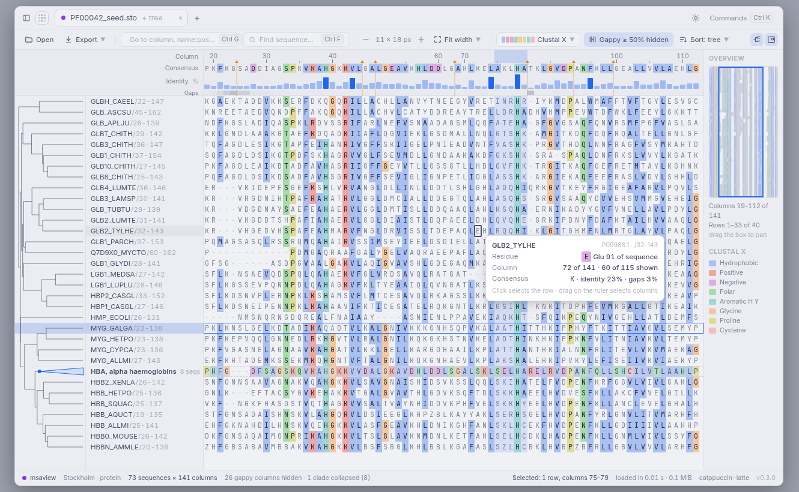
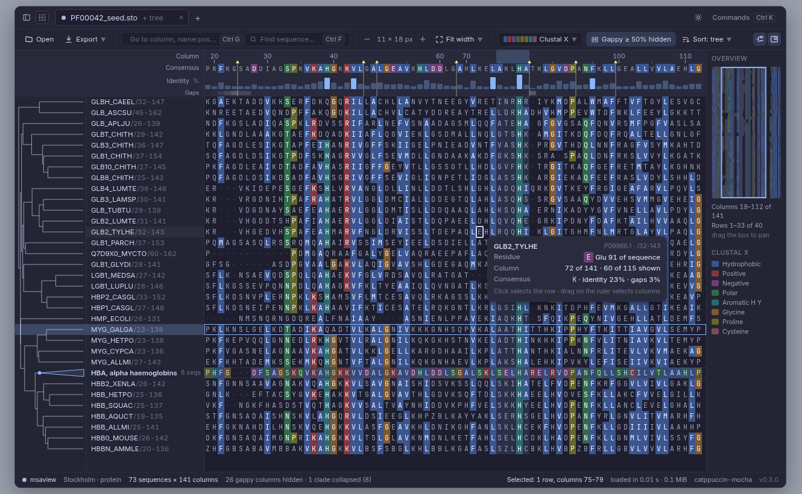
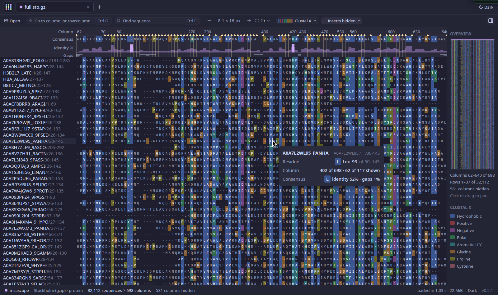
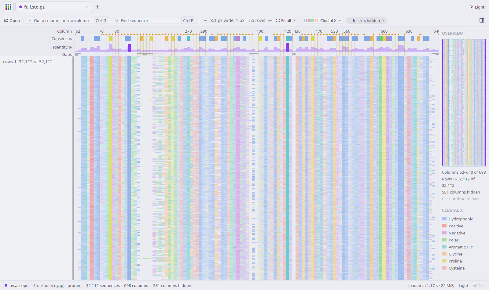
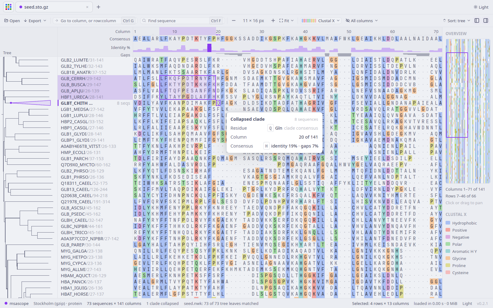
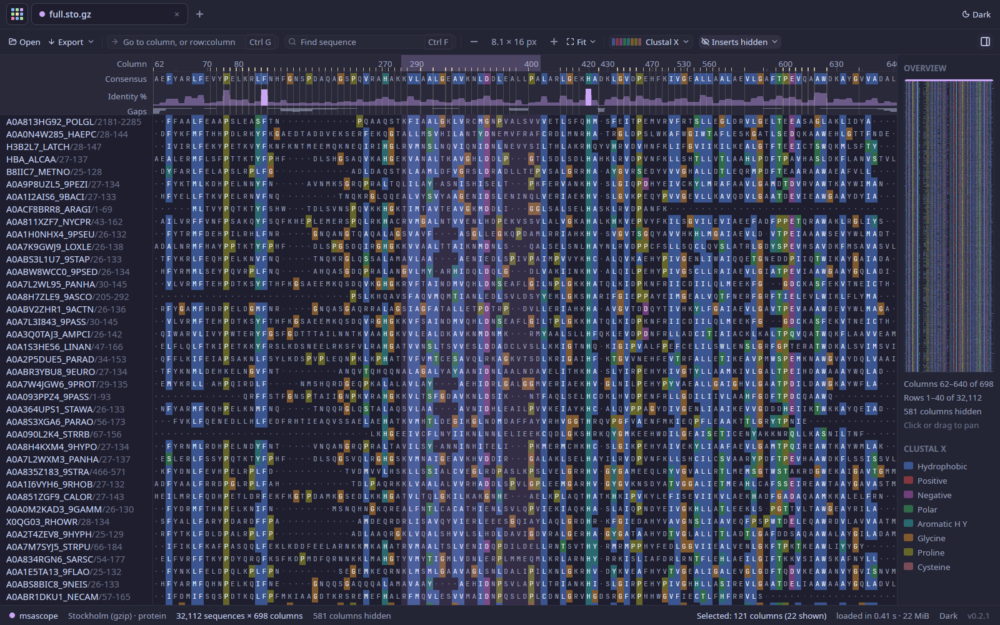

# msascope: large alignment viewer

`msascope` is a desktop viewer for multiple sequence alignments that stays smooth at sizes where the
usual viewers give up. 100,000 sequences × 30,000 columns loads in about 5 seconds into 1.6 GB of
RAM. The whole alignment then pans at the display's 60 frames per second, from the full overview
down to individual letters.

It was called msaview up to irit 0.2.1. It was renamed because MSAView is the long-standing name of
GMOD's web viewer (now JBrowseMSA, npm package `react-msaview`).

## Why

Jalview and AliView (Java) and SeaView show a few hundred rows comfortably, fail silently when they
run out of memory, and stall somewhere between 10^4 and 10^5 sequences. Surveillance alignments
(SARS-CoV-2, influenza, mpox) are now 10^5–10^6 genomes of ~30 kb. No native desktop viewer handles
that size; a WebGL viewer (Alignment Viewer 2.0) reported 10–100× gains from drawing on the GPU, so
`msascope` draws with GPUI, Zed's GPU-accelerated UI framework. See
[landscape](../research/landscape.md#2-viewers).

## Usage

```sh
msascope alignment.fasta          # or .fa.gz, .aln (Clustal), .sto (Stockholm)
msascope                          # then Open… (Ctrl+O)
msascope alignment.fasta --stats  # load, print sizes and timings, exit (no window)
msascope silk.fasta --type protein # residue type given instead of guessed: dna, rna or protein
msascope PF00042.sto --tree PF00042.nwk  # rows in the order of a Newick tree
msascope big.fa --stats --tree big.nwk   # also time reading, matching and ordering the tree
```

`--type` also applies to files opened later with Open…. Open… (and dropping files on the
window) takes alignments and trees: a tree is matched to the open alignment, and an alignment
and a tree dropped together are opened as a pair.

| Input | Action |
|---|---|
| Wheel / trackpad | Scroll (Shift+wheel: horizontal) |
| Drag | Pan; a click without moving places the cell cursor and clears the selection |
| Shift+drag, Shift+click | Select a block (from the cursor, or where the drag started) |
| Click a name | Select its row; Ctrl (⌘ on macOS) adds or removes a row, Shift extends, dragging extends |
| Click or drag on the track header | Select columns; Ctrl adds or removes, Shift extends |
| Arrows | Move the cell cursor (the first press puts it on the top-left cell in view); Shift extends a block; Ctrl+Left/Right jump to the next run of residues or the edge, Ctrl+Up/Down to the first or last row |
| Alt+arrows | Pan by 1/8 of the view |
| Page Up/Down, Home/End | Cursor by a page, to the row's first or last column; Ctrl+Home/End to the corners |
| Ctrl+A / Escape | Select everything / clear the selection (a second Escape removes the cursor) |
| Ctrl+C / Ctrl+Shift+C | Copy the selection as FASTA / as residues only, one row per line |
| Ctrl+E | Export the selection as FASTA |
| Click a node in the tree | Collapse its clade into one row, or expand it again |
| `t` | Tree order or file order (with a tree) |
| Ctrl+wheel | Zoom at the pointer (Ctrl+Shift: columns only, Ctrl+Alt: rows only) |
| `+` / `-` | Zoom in / out by √2 |
| `0` / `w` / `h` | Fit all / fit width / fit height |
| `r` | Back to the readable zoom a file opens at |
| Ctrl+G | Go to a column (`15000`) or row and column (`250:15000`, the row in the order shown); with both, the cursor goes there |
| Ctrl+F | Find sequences by name (substring, case-insensitive); Enter / Shift+Enter for next/previous |
| `s` / `d` / `c` | Next colour scheme / differences from the consensus on and off / "by conservation" on and off |
| `i` / `g` | Hide or show insert columns / gappy columns (at the threshold chosen in the toolbar, 50% by default) |
| Hover | A card next to the pointer: sequence, residue and its position in the sequence, column, consensus (over the track header: the column) |
| Click or drag in the overview | Pan there |
| Drag the name panel's right edge | Resize it (120–480 px, remembered); the tree panel's edge too (60–480 px) |
| Drop files on the window | Open an alignment, a tree, or both |

A file opens at a readable zoom, not fitted to the window: the whole alignment at about 11 × 16
pixels per cell if it fits; otherwise rows at 16 pixels, so names and residues can be read, and
columns fitted to the width when that leaves at least 7 pixels per column, enough for letters (else 11 pixels). The
fit zooms use the exact scale, so the alignment fills the window with no empty band; they never
zoom in past 11 × 16 pixels. `+` and `-` then move in steps of √2, from about 1/260,000 to 32
pixels per cell. Letters appear once cells are at least 7 × 10 pixels, names once rows are at
least 8 pixels tall.

The window shows, from the top: a title bar with the open file and the theme menu (System,
Light, Dark; System follows the OS), a toolbar, and the track header: column ruler, consensus
(most common residue per column), identity (bar height = share of sequences carrying the
consensus residue, strong colour at 90% or more) and gaps (share of gaps per column). The sequence
names stay in a panel on the left while the alignment scrolls, as `ID` and a dimmer `/start-end`
for Pfam-style names; when rows are too thin to label, the panel shows the visible rows in words
("rows 1,201–1,260 of 32,112") and a marker of where the view sits. The status bar shows the file
format and residue type, the size, the hovered cell, the selected row, the load time and memory,
and the theme. On the right, the overview panel shows the whole alignment (the shown columns),
the visible area as a box, the visible range and the legend of the colour scheme; the toolbar
button at the right end hides it. Settings (theme, name panel width, overview, gappy threshold)
are saved in `msascope/settings.toml` in the
platform's config folder (`~/.config` on Linux).

### Colour schemes

Chosen from the toolbar's colour menu (or `s`); proteins open in Clustal X, nucleotides in
Nucleotide.

| Scheme | For | Colours |
|---|---|---|
| Clustal X | protein | Hydrophobic blue, positive red, negative magenta, polar green, cysteine pink, glycine orange, proline yellow, aromatic H/Y cyan, only where the column passes the group's rule (the table in Jalview's Clustal X documentation, e.g. A, I, L, M, F, W, V when more than 60% of the column is W L V I M A F C H P; G and P always). Shares are of all rows, gaps included. |
| Percent identity | both | Three steps of the accent by the share of the column with the same residue: more than 80, 60, 40% |
| Hydrophobicity | protein | Kyte–Doolittle, blue (hydrophilic) through neutral to orange (hydrophobic) |
| Nucleotide | DNA, RNA | A green, C blue, G orange, T/U red, other codes grey |
| Differences | both | Residues that match the column consensus faded toward the background, the rest in their group colour |

"By conservation" (`c`) fades any scheme's fill toward the background by (1 − column identity).
Every scheme has fills for the light and the dark theme; behind letters they are pale (light) or
dark (dark), and a test checks that the letter ink keeps at least 4.5:1 contrast on every fill.
Residues a scheme leaves unfilled are drawn as muted letters on the background; gaps are the
background with a small dot.

Below one pixel per cell in either direction, cells are not sampled one by one. Each pixel shows
its cells' majority residue in the scheme's strong colour, mixed from the background by
0.08 + 0.72 × (1 − the share of cells that differ from their column's consensus), so conserved
regions are strong and variable or gappy ones faint; a gap majority is the background with 3% of
the text colour. Differences keeps its own rule (faded majority, mixed toward the text colour by
the differing share).

### Hiding columns

Insert columns (`i`) and gappy columns (`g`) can be hidden from the toolbar's columns menu. Insert
columns are hidden by default when the file has them. Gappy columns are those with at least 25,
50 (default), 75, 90 or 100% gaps. The ruler keeps the alignment's own column numbers and marks
each hidden run with a thin tick at its foot and a faint line through the tracks; runs closer
than 6 px share one tick, drawn 2 px wide. Over the ruler, the hover card lists the hidden
columns on either side of the column under the pointer ("Hidden before: 4 columns, 437–440"); the status bar and the
overview give the number hidden. Go-to (Ctrl+G) takes the alignment's column numbers; a hidden
column goes to the next shown one. The hover card gives both numbers ("72 of 698 · 60 of 115
shown"). Hiding rebuilds the pyramid for the shown columns in the background; the view keeps the
old one until the new one is ready.

### Selection, copy and export

A selection is a set of rows and a set of columns, kept in the alignment's own numbering so it
survives hiding columns and reordering rows. Rows only select whole rows, columns only whole
columns, both a block. Selected rows are highlighted in the name panel, selected columns in the
ruler, and selected cells get a light accent wash with an accent outline around each block. The
status bar gives the size ("Selected: 6 rows × 13 columns", with "(16 shown)" when hidden columns
fall inside it). Selecting a collapsed clade's row selects all its sequences.

Ctrl+C copies the selection as FASTA (`>name` lines, one line of residues per sequence), Ctrl+Shift+C
as residues only; both in the order the rows are shown. A selection over 64 MiB goes to a file
instead. The toolbar's Export menu writes the selection or every row to a FASTA file (in the
background), and has two options for copying and exporting: **Include hidden columns** (off by
default: what is shown is what is written; on, a column range selected across hidden columns
includes them) and **Leave out gaps** (the ungapped sequences). Lower case is not kept (see
Formats). Image export (PNG, SVG) is not built yet.

### Tree

A Newick tree orders the rows and draws on the left of the names. It is taken from, in this
order: `--tree FILE`; a tree opened or dropped with the alignment; the Stockholm file's own
`#=GF NH` lines; a file next to the alignment with the same stem and `.nwk`, `.newick`, `.tree`
or `.treefile` (`PF00042.sto.gz` tries `PF00042.sto.nwk`, then `PF00042.nwk`, …). Open… or a drop
loads another tree for the open alignment.

The parser reads quoted labels (`'a b'`, `''` for a quote), labels on internal nodes (names or
support values), branch lengths, `[...]` comments (NHX annotations are ignored), and line breaks
anywhere; only the first tree of a file is used. It never recurses, so very deep trees (a 200,000
level caterpillar in the tests) are fine. Leaves are matched to sequences by the first rule that
finds one: the full name (also with `_` read as a space), the first word of a FASTA header, the
name before its last `/` (Pfam's `GLB2_TYLHE/32-143` for a leaf `GLB2_TYLHE`), the accession
(`#=GS … AC`, with or without its `.version`). Rules after the first only use keys that belong to
one sequence. The status bar reports the result ("73 of 75 tree leaves matched; 2 not in the
alignment (…); 3 sequences not in the tree, shown at the end"), and the full list of unmatched
leaves is printed to the terminal. Sequences the tree lacks follow the tree's rows, under a
"not in tree" line.

Branches are drawn to scale when the tree has lengths (every branch counts as 1 when it has none).
Click an internal node to collapse its clade: it becomes one row showing the clade's consensus
(per column, a gap where more than half the sequences have one, otherwise their most common
residue), labelled with the node's name when it has one (support values are not names) or the
first sequence, and the number of sequences; the tree draws it as a triangle. Click again to
expand. The status bar counts the collapsed clades. The toolbar's Sort menu (or `t`) switches
between tree order and file order (collapsing only applies in tree order), loads another tree or
removes it; the button next to it hides the tree panel.

Reordering and collapsing rebuild, in the background, the row order, the clade consensus rows
and a pyramid for the rows shown; the view keeps the previous one until the new one is ready and
keeps the same row at the top. Below a few pixels per subtree the panel draws a subtree as a
faint wedge instead of its branches.

### Hover card

Over a cell: the sequence ID with its accession (from Stockholm `#=GS <name> AC`) and range; the
residue, its three-letter name and its position in the ungapped sequence, counted from the
name's `/start-end` when it has one (Pfam, HMMER) and from 1 otherwise; for a gap, the residues
it falls between; the column; and the column's consensus, identity and gap share. Over the track
header the card shows the column only (and nearby hidden columns). Over a collapsed clade it
shows the clade's consensus residue. After a key moves the cursor, the card shows the cursor's
cell next to it; moving the pointer brings it back. It hides while dragging and after a scroll
until the pointer moves.

## Formats

| Format | Detected by | Notes |
|---|---|---|
| Aligned FASTA | first line starts with `>` | Wrapped or unwrapped, `\r\n` line ends, gzip (`.gz`, detected by content) |
| Clustal | `CLUSTAL`, `MUSCLE` or `PROBCONS` header | Consensus lines and trailing residue counts are ignored |
| Stockholm | `# STOCKHOLM` header | First alignment in the file; `#=GC RF`, `#=GS <name> AC` and `#=GF NH` (a tree) are read, other markup is skipped; blocks must be separated by a blank line |

A UTF-8 byte order mark and blank lines before the header are ignored.

Every sequence must have the same number of columns; a file that isn't aligned is refused with the
name of the first sequence that differs. In Clustal and Stockholm, a name that appears twice in one
block is refused with that name and its line; that is also what happens to a Stockholm or Clustal
file whose blocks have no blank line between them (the repeated names look like duplicates), so add
the blank lines. `-`, `.` and `~` are gaps and lower case is shown as upper case, but insert
columns are kept: a column is an insert column when every row has lower case or `.` there (the
A2M, HMMER and Pfam convention), or, in Stockholm, when `#=GC RF` marks it with `.` (RF wins
when it covers every column). A file that writes gaps as `.` in upper-case match columns (Pfam
seed alignments) therefore has no insert columns except all-`.` ones. `?` is read as N (nucleotides) or X (protein). In nucleotides, hard-masked `X` and `*` are
kept as written.

The residue type comes from the residues (gaps excluded) of the whole file for Clustal and
Stockholm, and from the first 64 K residues across the first rows for FASTA. It is nucleotides when
no residue is a letter only an amino acid can have (E, F, I, L, P, Q, …) and at least 90% of the
residues are A, C, G, T, U or N; otherwise protein. `X`, `*` and `?` count neither way, so
hard-masked DNA stays DNA, and a sequence made only of them is protein. The 90% share matters
because many real proteins use only letters that are also IUPAC nucleotide codes (silk fibroin
`GAGAGS…`, glycine-rich and cysteine-rich peptides); they fall far below it, while DNA with
ambiguity codes stays far above it. Short or low-complexity sequences can still be read the wrong
way: an antifreeze glycoprotein `AATAATAAT…` is letter for letter the (AAT)n DNA repeat. Give
`--type protein` (or `dna`, `rna`) when the guess is wrong; with `--type`, a residue that doesn't
fit the type is reported instead of switching type.

Nucleotides are shown as DNA (T), RNA (U), or, when both T and U occur, as DNA/RNA with T and U kept
apart. If a later FASTA row needs a wider type (a U in a DNA alignment, an `X` or `*`, or an
amino-acid-only letter), the rows read so far are converted; in the one case where that would lose
information (a `?` already stored as N, which must become X), the file is read again from the
start.

## Design

The core (parsing, storage, summaries, view geometry, tile drawing) is a plain Rust library with
unit tests and no GUI dependency; the GPUI code only handles windows, input and painting.

**Storage.** One small code per residue, row-major. Nucleotides use 16 codes (gap plus the 15 IUPAC
letters) packed two per byte, so a 30 kb genome takes 15 kB; amino acids take one byte. Rows are
stored in blocks of 1,024 so the matrix can grow while a file streams in, without reallocating
(and briefly doubling) gigabytes. Lower case is not kept and `.` becomes `-`; which columns are
insert columns is kept as a bitset, one bit per column. An alignment that has
both T and U needs a 17th code, and one with `X` or `*` needs codes beyond the 16, so those are
stored at one byte per residue like protein (no residue is rewritten to fit the 4-bit codes).

**Loading.** FASTA is read in 64 MB batches; the records in each batch are encoded into their rows
in parallel. Plain and gzip input take the same path and memory stays at the packed matrix plus one
batch. (The first version memory-mapped the file instead: parsing was 1 s faster, but the mapped
3 GB file counted towards resident memory and peaked at 4.3 GB.) If the type widens after rows
were packed, the packed rows are converted to one byte per residue, briefly holding the old and the
new matrix. Clustal and Stockholm are read twice, line
by line: the first pass collects names, row lengths and the residue counts that decide the type,
the second encodes each line straight into its row, so memory is the packed matrix plus the names
(gzip is decompressed twice). That path is single-threaded.

**Column summaries.** One pass counts every residue per column (consensus, identity, gap share,
the share of each residue code, 32 bytes per column, and the Clustal X rule results).
The work is split by blocks of 1,024 columns so each thread's counters (128 KB) stay in cache, and
each block keeps only the three results per column (9 bytes) once counted;
split by rows instead, it took 15 s rather than 1 s on the 100,000 × 30,000 test.

**Pyramid.** For zoomed-out views, level *k* summarises blocks of 8·2^k × 8·2^k cells with the most
common code and the share of the block's cells (gaps included, so a gappy block looks calmer)
holding a residue that differs from its column's consensus; N and X never count as differences.
Level 0 is counted from the cells. Each higher level combines 2 × 2 blocks of the one below, each
weighted by the number of cells it covers, so the short blocks at the right and bottom edges don't
count as much as full ones: the difference share stays exact up to rounding, while the most common
code is the child majority with the most weight, an approximation of the true majority. Ties go
to a residue rather than the gap, then to the lower code. For 100,000 ×
30,000 the pyramid takes 119 MiB next to the 1,430 MiB matrix.

**Rendering.** GPUI does not expose custom shaders, so the alignment area is drawn as image tiles
of 256 × 256 device pixels. A tile is rasterised once on the CPU (in parallel across tiles, one
pixel = one cell or one pyramid block, picking the coarsest pyramid level that is still at least
one block per pixel, or below one pixel per cell the density of the cells each pixel covers) and then composited by GPUI's GPU sprite atlas; tiles are cached per scale, colour mode and
theme, and evicted (and freed from the GPU atlas) when far off screen. No UI element
is created per cell. When letters are visible, each distinct letter is shaped once per frame and
painted per visible cell. Tracks are drawn as runs of equal-colour quads, one entry per pixel
column.

## Measured

Machine: AMD Ryzen 5 PRO 4650U (6 cores, 12 threads), 30 GB RAM, Arch Linux (kernel 7.2.11),
Hyprland 0.56 on Wayland, built-in 1920 × 1080 display at 60 Hz with 1.25 scaling, integrated
Radeon graphics. Rust 1.99.1, release build (thin LTO). Test data from `msagen` (below) in `/tmp`,
which is RAM-backed (tmpfs) here, so these are warm-cache numbers; reading from a disk adds the
time to read the file.

Gzip loading is limited by decompression, which runs on one thread; the parsed batches are still
encoded in parallel. The gzip row is a single run; four loads of the plain file (one with
`--stats`, three inside the viewer) took 5.1–5.4 s.

Release binaries: `msascope` 36 MB (most of it GPUI and the bundled icon set), `msagen` 0.4 MB.

Peak resident memory is the process's own high-water mark (`VmHWM`), also checked from outside
with `getrusage` on the child process; MiB = 2^20 bytes.

| Alignment | File | Load (parse + columns + pyramid) | Peak RSS, no window (`--stats`) | Peak RSS, viewer |
|---|---|---|---|---|
| 1,000 × 1,000 DNA | 1.0 MB | under 0.01 s | 9 MiB | 126 MiB |
| 100,000 × 30,000 DNA | 3.0 GB | 5.1 s (2.1 + 1.1 + 1.7) | 1,567 MiB | 1,746 MiB |
| 100,000 × 30,000 DNA, gzip | 1.18 GB | 17.1 s (13.8 + 1.2 + 1.9) | 1,572 MiB | not measured |

The viewer column is the high-water mark just after loading for the small file, and over the whole
`--bench` session (four zoom levels of panning) for the large one.

**Frame smoothness.** `msascope FILE --bench` opens the window and pans continuously, by 1/12 of
the view width and 1/24 of its height every frame for 240 frames, at four zoom levels; it records
the time between frames and the time spent in the alignment's paint callback. On the 100,000 ×
30,000 alignment:

| Zoom | Frame interval median / p95 / max | Frames over 25 ms | Paint median / p95 | Tiles drawn |
|---|---|---|---|---|
| Whole alignment (fit) | 16.7 / 19.4 / 66.0 ms | 2 of 240 | 7.0 / 12.0 ms | 28 |
| 1 px per cell | 16.7 / 18.9 / 35.3 ms | 1 | 5.4 / 13.5 ms | 853 |
| 4 px per cell | 16.7 / 17.0 / 17.2 ms | 0 | 1.8 / 3.2 ms | 853 |
| Letters (11 × 16 px) | 16.6 / 20.6 / 25.9 ms | 1 | 6.8 / 15.3 ms | 853 |

16.7 ms is the display's refresh interval, so the median frame is never late. The occasional slow
frame comes when the pan crosses into a new row of tiles and several are rasterised at once, or
when the view switches zoom (the 66 ms maximum is the first frame of the overview phase). These
are measurements from an automated pan, not a judgement by eye with a real mouse. At the fit zoom the whole alignment is on screen, so the pan has nothing to reveal: that row
measures redrawing, not tile drawing. One machine and one display so far; 120 Hz displays and
weaker GPUs are untested.

**After the rename and the first redesign steps (2026-11-11).** The table above was measured
before them, on the 100,000 × 30,000 file. The redesign was checked against the last msaview
build (commit `b87af1d`) on the same machine, with a smaller file (`msagen 20000 10000`, 200 MB,
in `/tmp`) because the machine had little free memory, and with the two builds run alternately
because other jobs kept it busy (load average 10 to 55 on 12 threads). Window 1280 × 800.

| | msaview (before) | msascope (after) |
|---|---|---|
| Load, `--stats`, median of 6 | 0.95 s (0.38 + 0.21 + 0.37) | 0.93 s (0.38 + 0.19 + 0.36) |
| Peak RSS, `--stats` | 166 MiB | 168 MiB |
| Paint median, whole alignment (fit) | 8.8 ms | 5.5 ms |
| Paint median, 1 px per cell | 9.7 ms | 4.8 ms |
| Paint median, 4 px per cell | 2.6 ms | 2.5 ms |
| Paint median, letters (11 × 16 px) | 14.6 ms | 12.5 ms |
| Peak RSS, `--bench` | 275–282 MiB | 287–292 MiB |

Paint medians are the median over 6 (before) and 7 (after) `--bench` runs. In each of the five
runs made back to back, msascope's letters paint was 1.2 to 3.0 ms lower. Letters got cheaper because
each cell now paints its glyph directly instead of a one-letter text line. The fit row is not a
like-for-like comparison: msaview fitted to a √2 zoom step and msascope to the exact scale. On
this busy machine the frame interval medians were 17–27 ms for both builds, so the 16.7 ms
figures in the table above were not reproduced here. Two of 15 runs (one of each build) stopped
advancing in their first phase and were dropped; the bench advances one step per frame, and a
window that is not shown gets no frames.

**After colour schemes, density, the hover card and hidden columns (2026-11-11).** Checked
against the build before them (commit `7e209c6`) on the same machine and file
(`msagen 20000 10000`, 200 MB in `/tmp`), the two builds run alternately. The machine was busy
again (load average 11 to 60 on 12 threads), so single runs varied by a factor of two or more
(the pyramid step, whose code did not change, took 0.39 to 1.34 s); the medians below are what
can be compared, and the differences are within that noise. Window 1280 × 760; `--bench` leaves
the overview panel out, so the alignment area is the same size in both builds.

| | before (`7e209c6`) | after |
|---|---|---|
| Load, `--stats`, median of 16 (fastest) | 3.01 s (1.49 s) | 2.60 s (1.49 s) |
| Column summaries step, median of 16 | 0.80 s | 0.78 s |
| Peak RSS, `--stats` | 168 MiB | 167–168 MiB |
| Paint median, whole alignment (fit), median of 5 | 3.9 ms | 4.2 ms |
| Paint median, 1 px per cell | 3.7 ms | 4.2 ms |
| Paint median, 4 px per cell | 1.9 ms | 1.7 ms |
| Paint median, letters | 7.9 ms | 8.2 ms |
| Peak RSS, `--bench` | 282–286 MiB | 285–291 MiB |

Memory added: the insert-column bitset, 1 bit per column (3.7 KiB at 30,000 columns); the share
of each residue code per column, 32 bytes per column (0.92 MiB at 30,000 columns) and the Clustal
X result, 4 bytes per column; accessions only for Stockholm files that have them. While columns
are hidden, a second pyramid for the shown columns is kept (at most the size of the first: 7 MiB
here, 119 MiB at 100,000 × 30,000), and while it is rebuilt the old one is kept too. The bench
does not hide columns, so the time of that rebuild at 100,000 × 30,000 has not been measured.
PF00042 full (Stockholm, gzip, 4.8 MB) loads in 0.4 s.

**After selection, export, the cursor and the tree panel (2026-11-11).** Checked against the
build before them (commit `4d1f9be`), both built the same way (release, thin LTO, 16 codegen
units) and run alternately on `msagen 20000 10000` (200 MB in `/tmp`), window 1280 × 760, no tree
loaded. The machine was busy for the first runs (load average 14 to 47) and calmer for the last
ones (7 to 13); the table gives the calmer runs.

| | before (`4d1f9be`) | after |
|---|---|---|
| Load, `--stats`, median of 15 (fastest) | 0.56 s (0.43 s) | 0.55 s (0.42 s) |
| Load, after/before ratio of alternating pairs, median of 15 | | 0.98 |
| Peak RSS, `--stats` | 167–168 MiB | 169 MiB |
| Paint median, whole alignment (fit), median of 6 | 2.75 ms | 2.5 ms |
| Paint median, 1 px per cell | 2.95 ms | 2.75 ms |
| Paint median, 4 px per cell | 1.2 ms | 1.3 ms |
| Paint median, letters | 4.95 ms | 5.15 ms |
| Frame interval median, all four zooms | 16.6–16.7 ms | 16.7–17.2 ms |
| Peak RSS, `--bench` | 283–284 MiB | 296–297 MiB |

In the busier runs (40 load pairs, 8 bench runs of each build) the load ratio was 1.025 and the
fit paint median 0.9 ms higher after. With the same timing instrumentation added to both builds
the order flipped: fit 0.5 ms lower after, and `--bench` peak RSS 297 MiB before, 283 MiB after.
The code on that path is unchanged without a tree or a selection, so those differences (and the
13 MiB in the table) come from how each build is laid out, not from new work. At the fit zoom
about 95% of the paint time is the track header (the per-pixel track bars), in both builds.

The tree, on a synthetic 230,000 × 300 alignment with a 230,000-leaf tree
(`msagen 230000 300 t230k.fa --tree t230k-tree.nwk`; 7.6 MB of Newick, 459,999 nodes):

| | |
|---|---|
| Read and parse, `--stats --tree`, 3 runs on the busy machine | 0.12–0.47 s |
| Match leaves and build the index | 0.34–0.76 s |
| Row order | 0.03–0.12 s |
| Pyramid in tree order | 0.37–0.76 s |
| In the viewer, calmer machine, 3 runs: parse / match / layout | 0.07–0.09 / 0.11–0.15 / 0.08–0.16 s |
| Collapsing a clade of 165,000 sequences (layout rebuild) | 0.09 s |
| Memory: tree and its index / row view | 25 MiB / 2 MiB |
| Peak RSS, `--stats`, with and without the tree | 120 MiB both (the peak is during parsing) |
| Peak RSS, `--bench`, with / without the tree | 258–264 / 247 MiB |

`--bench` on that file, 3 runs each, with and without the tree panel:

| Zoom | Paint median, with / without tree | Frame interval median, with / without |
|---|---|---|
| Whole alignment (fit) | 1.6 / 0.7 ms | 16.7 / 16.7 ms |
| 1 px per cell | 1.7 / 0.9 ms | 16.7 / 16.7 ms |
| 4 px per cell | 1.1 / 0.8 ms | 16.7 / 16.7 ms |
| Letters | 4.4 / 5.7 ms | 16.7 / 17.6 ms |

Reading, matching and laying out the tree run in the background, and the window keeps drawing
meanwhile; with the tree shown the bench still pans at 60 frames per second. A first version that
went into subtrees down to 3 px drew thousands of 1 px lines at the fit zoom (5.8 ms per paint
there); drawing subtrees under 6 px as wedges and skipping lines already covered in their pixel
row brought that to 1.6 ms.

## Test data

`msagen ROWS COLS OUT [--protein] [--seed N] [--tree TREE.nwk]` writes a synthetic alignment (OUT ending in `.gz` is
gzipped; ROWS and COLS must be at least 1, and write errors end it with a non-zero exit): a random reference, 32 clades with shared mutations, and per sequence a few
substitutions, an occasional deletion, an N run and ragged ends, like a viral surveillance
alignment. It writes the 3 GB, 100,000 × 30,000 file in under 2 seconds. `--tree` also writes a
random binary Newick tree whose leaves are the sequences, each clade's sequences under one
subtree (labelled `cladeK`), with random branch lengths.

```sh
msagen 1000 1000 /tmp/small.fa
msagen 100000 30000 /tmp/big.fa
msagen 230000 300 /tmp/t230k.fa --tree /tmp/t230k-tree.nwk
```

Generated files are for testing only and are not kept in the repository.

## Installing

The [installer](../install.md) puts `msascope` in place with the other tools: a signed, notarised
`msascope.app` on macOS, a binary on Linux (x86_64 and aarch64). There is no Windows release yet (see Building).

Started without a file, msascope shows a card with **Open…** and **Try a sample**. The sample is a synthetic 2,000 × 3,000 nucleotide alignment (written to the temp folder),
generated the same way as `msagen`'s test files. On the command line: `msascope my_alignment.fa`.

## Building

`msascope` needs a desktop build environment (GPUI); the other irit tools do not. On
Debian/Ubuntu, install `pkg-config libfontconfig-dev libxkbcommon-dev libxkbcommon-x11-dev` first.
This list comes from the build scripts and linked libraries, and is not yet confirmed on a clean
Ubuntu install. macOS builds run on GitHub's runners for every release. `msascope.yml` also builds it for
Windows (x86_64); that build has only been checked to start (`--help`), not used. The core library and `msagen` build without GPUI:
`cargo test --no-default-features`.

It uses GPUI through Longbridge's `gpui-kit` 0.9.1, which pins a GPUI snapshot (`gpui-pre`
0.3.12); the `gpui` crate on crates.io is from October 2025. Versions are pinned exactly because the
API changes often.

## Planned redesign

Phases 0–6 are built (see "Built so far" below). The pictures here are **mockups**, a
static drawing of the planned main window at its
default size (1280 × 800). It shows 40 of the 73 sequences of Pfam's globin seed alignment
([PF00042](https://www.ebi.ac.uk/interpro/entry/pfam/PF00042/)), ordered by a tree computed from
those rows for the drawing only.





Built so far:

- Light and dark themes (Catppuccin Latte and Mocha, magenta accent) and System, which follows
  the OS appearance; a title bar with the file tab, a toolbar, and a status bar. One file at a
  time; tabs for several files are not built.
- A resizable sequence-name panel, and opening at a zoom where names and residues are readable.
  Fit, Fit width and Fit height, at the exact scale, replace the single fit-everything zoom.
- The design system behind them (colour tokens, sizes, fonts, shortcut labels), adapted from
  Kantor by the same author.
- Colour schemes (Clustal X with its column rules, percent identity, hydrophobicity, nucleotide,
  differences, by conservation) in both themes, and density rendering at low zoom.
- The overview panel (planned for later; it reuses the tile renderer, so it came early).
- The hover card with the residue's position in the ungapped sequence.
- Hiding insert and gappy columns, with the ruler keeping the original numbers.
- Selecting rows, columns and blocks; copy and FASTA export; drag-and-drop; the cell cursor.
- The Newick tree panel: rows in tree order, collapsible clades shown as their consensus.

The current app with Pfam's PF00042 full alignment (32,112 × 698; 581 insert columns hidden,
117 shown), dark theme at the zoom it opens at, with the hover card:



The same alignment in the light theme, fitted to the window (Fit all): each pixel row covers 55
sequences, and conserved columns show as strong stripes:



Pfam's PF00042 seed (73 × 141) with an illustrative neighbour-joining tree built from pairwise
identity for this picture (Pfam's API has no tree for this family), one clade collapsed (8
sequences shown as their consensus), a block selected, and the cursor with its hover card:



PF00042 full, dark theme, inserts hidden, with a range of columns selected by dragging on the
ruler (121 columns of the alignment, 22 of them shown):



Still to come, in order of priority:

- Loading progress and cancel (phase 7).
- Image export (PNG of the view, SVG of a region); sort and filter rows; go to `name:position`;
  motif search; a reference row; Stockholm `#=GC` tracks; recent files (phase 8).
- The tree panel's right-click menu from the spec (collapse to a depth, select a clade's rows,
  show only a clade, ladderize) is not built; clicking a node collapses or expands it.

Each step has to keep the load and paint times in [Measured](#measured) within 5% and 1 ms.

## Known gaps

- Single machine tested (Linux, Wayland). The macOS and Windows builds are only checked to start
  (`--help`) on GitHub's runners.
- Mouse wheel, drag and the Open… dialog were not exercised by an automated test; zoom keys, colour
  mode, go-to and search were (driven through the keyboard while taking screenshots).
- The whole alignment must fit in RAM: about half a byte per nucleotide cell, so 10^6 × 30 kb needs
  about 15 GB. A memory-mapped packed cache file would lift that.
- Gzip input loads about 3× slower than plain FASTA because decompression is single-threaded.
- Loading blocks the view (a "Loading…" status, no progress bar) and cannot be cancelled.
- Upper pyramid levels approximate the majority (area-weighted majority of majorities).
- Clustal and Stockholm load on one thread and read the file twice; fine for typical sizes, slower
  than FASTA for very large files.
- No editing, image export, sorting by similarity, or computing a tree (bring a Newick file).
- Drag-and-drop and the Export save dialog were not exercised by an automated test; selection,
  copy (read back from the clipboard), the cursor keys and collapsing clades were (driven with a
  virtual mouse and keyboard while taking screenshots).
- Collapsing a clade or switching the order rebuilds the row order, clade consensus and pyramid
  for every row in the background (0.08–0.16 s at 230,000 × 300 on the test laptop; longer for
  wide alignments, not measured); the old layout stays on screen meanwhile.
- Lower-case residues (often used for unaligned or masked regions) are shown as upper case; only
  whole insert columns are kept, not which single residues were lower case.
- The density view samples at most 32 pyramid blocks or cells per pixel, so it is an estimate
  when a pixel covers more than that.
